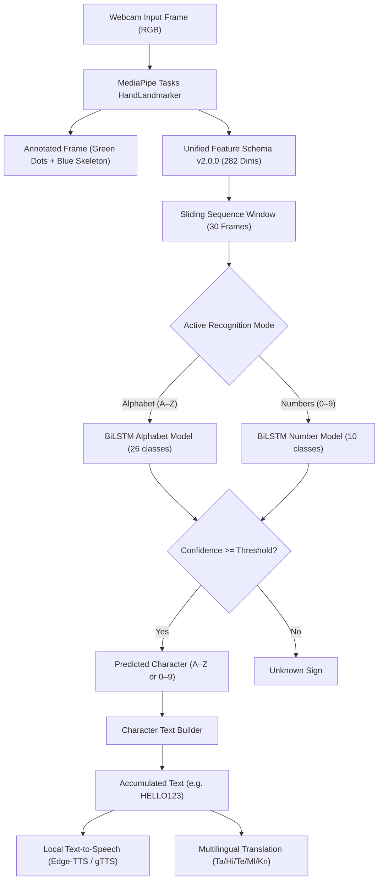

# SignBridge AI — Real-Time Indian Sign Language (ISL) Recognition

SignBridge AI is an AI-powered Indian Sign Language (ISL) recognition and assistive communication platform built strictly in Python. It detects hands in real-time from a webcam, extracts MediaPipe hand landmark geometry, and classifies signs using deep learning.

---

## 1. Main Project Objective

SignBridge AI focuses exclusively on **character-by-character real-time Indian Sign Language recognition**:

1. **English Alphabet Fingerspelling (A through Z — 26 classes)**:
   - Recognizes static and movement-based ISL fingerspelling handshapes.
2. **Numbers (0 through 9 — 10 classes)**:
   - Recognizes standard ISL number signs (0 through 9).
3. **Character-by-Character Text Generation**:
   - Recognized characters assemble sequentially into readable text (e.g., `HELLO123`).
   - Supports manual confirmation, auto-add stabilization with neutral release gating, backspace, clear text, multilingual translation, and local text-to-speech (TTS).

> [!NOTE]
> Large-vocabulary word recognition, gloss translation, and sentence-level word vocabularies are **not** part of the active pipeline. All historical word-mode modules are decoupled and retained only as unimported reference files.

---

## 2. Key Features

- **Single Camera Interface**: Displays exactly one unified webcam stream with high-contrast green landmark dots (radius 5) and blue skeleton connection lines.
- **Unified Feature Schema (v2.0.0)**: Fixed 282-dimensional feature vector (140 Left Hand + 140 Right Hand + 2 Hand Presence Flags) shared identically across training and live inference.
- **Strict Model Compatibility**: Explicitly rejects incompatible models (`IncompatibleModelError`); never silently pads, truncates, or slices feature dimensions.
- **Genuine Confidence Gating**: Unrecognized or low-confidence hand poses report `Unknown Sign`, preventing arbitrary guesses on random handshapes.
- **Character Text Builder**: Add Character, Backspace, Clear Text, and Auto-Add with mandatory neutral hand release to prevent runaway duplicate characters (e.g., prevents `AAAAA`).
- **Per-Session State Isolation**: Gradio `gr.State` isolates recognition pipeline instances per user connection, preventing cross-user text contamination.
- **Multilingual Translation & TTS**: Translates assembled text to Tamil, Hindi, Telugu, Malayalam, Kannada, and English with offline dictionary fallback and speech synthesis.
- **Comprehensive Verification**: 100% automated test pass rate across all unit and integration test suites.

---

## 3. Supported Recognition Classes

### Alphabet (26 Classes)
| Class | Category | Description / ISL Standard |
|---|---|---|
| `A`–`Z` | Alphabet | Standard Indian Sign Language (ISL) fingerspelling hand signs. Dynamic letters (such as `J` and `Z`) incorporate motion trajectories; static letters evaluate palm and finger kinematics. |

### Numbers (10 Classes)
| Class | Label | Description / ISL Standard |
|---|---|---|
| `0` | ZERO | Closed fist or circular 'O' shape |
| `1` | ONE | Index finger extended upright, others folded |
| `2` | TWO | Index and Middle fingers extended upright in V-shape |
| `3` | THREE | Thumb, Index, and Middle fingers extended |
| `4` | FOUR | Index, Middle, Ring, Pinky extended, thumb folded |
| `5` | FIVE | Open hand, all 5 fingers extended |
| `6` | SIX | Thumb touching Pinky tip, others extended |
| `7` | SEVEN | Thumb touching Ring tip, others extended |
| `8` | EIGHT | Thumb touching Middle tip, others extended |
| `9` | NINE | Thumb touching Index tip, others extended |

---

## 4. System Architecture



---

## 5. Model Weights & MediaPipe Asset Policy

> [!IMPORTANT]
> Model weights (`.keras`, `.h5`), task binaries (`.task`), and raw dataset arrays (`.npz`) are **intentionally excluded from Git** via `.gitignore` to comply with Git repository file size best practices. They are never claimed to be checked into the Git repository.

### Reproducible Asset Setup

Run the unified asset setup script to download MediaPipe task binaries and verify model availability:

```powershell
# 1. Download official MediaPipe hand_landmarker.task and verify model schemas
python scripts/setup_assets.py

# 2. To automatically train missing models from dataset manifests:
python scripts/setup_assets.py --train
```

If model files are not present on disk, the UI gracefully displays **"Model Not Available"** with actionable guidance instead of throwing unhandled exceptions or making fake predictions.

---

## 6. Installation & Setup (Windows PowerShell)

### Prerequisites
- Windows 10/11
- Python 3.11 or 3.12 (64-bit)
- Working USB webcam or laptop camera

### Step 1: Clone Repository
```powershell
git clone https://github.com/arunkumar-maa/sign.git
cd sign
```

### Step 2: Create & Activate Virtual Environment
```powershell
python -m venv .venv
.\.venv\Scripts\Activate.ps1
```

### Step 3: Install Dependencies
```powershell
python -m pip install --upgrade pip
pip install -r requirements.txt
```

### Step 4: Setup Assets
```powershell
python scripts/setup_assets.py
```

---

## 7. Launching the Application

Start the FastAPI backend and Gradio web interface simultaneously:

```powershell
python app.py
```

- **Gradio Web Interface**: [http://localhost:7861](http://localhost:7861)
- **FastAPI Interactive Docs**: [http://localhost:8001/api/docs](http://localhost:8001/api/docs)

---

## 8. Webcam Usage & Recognition

1. Open [http://localhost:7861](http://localhost:7861) in your browser.
2. Select the **"🎥 Live ISL Translator"** tab.
3. Choose your desired recognition mode:
   - **Alphabet (A–Z)**: For spelling English words using ISL fingerspelling (26 classes).
   - **Numbers (0–9)**: For ISL numbers (10 classes: 0 through 9).
4. Under the camera accordion, click the webcam icon to grant camera permissions.
5. The live camera feed displays your video with green landmark dots on your knuckles/fingertips and blue skeleton connection lines.
6. **Assembling Text**:
   - Hold an ISL sign. When the predicted character appears with high confidence, click **"➕ Add Character"**.
   - Use **"⌫ Backspace"** to delete the last character or **"🗑 Clear Text"** to reset.
   - Click **"🔊 Speak Text (TTS)"** to hear the assembled string spoken aloud.
   - Toggle **"⚡ Auto-Add"** for hands-free typing (requires 6 stable frames + mandatory neutral release before repeating the same character).

---

## 9. Dataset Collection & Model Training

### Data Collection Tab
1. Switch to the **"ISL Data Collection"** tab in the web UI.
2. Select the category (**Alphabet** or **Numbers**).
3. Type the exact verified label (e.g., `A` or `5`) and your signer ID (e.g., `S01`).
4. Click **Start Recording**, perform the sign, and click **Stop Recording**.
   - *Quality check:* Samples without valid hand landmarks are automatically rejected to prevent corrupted data.
5. Click **"Extract Hand Landmarks"** to convert saved clips to 282-dim sequences via `backend/vision/feature_schema.py`.

### Standalone Model Training (Strict Signer-Independent Splits)
Run dedicated training scripts directly from PowerShell:

```powershell
# Train Alphabet Model (A–Z, 26 classes) - Strictly evaluated on held-out signer_02
python scripts/train_alphabet.py --epochs 25 --batch-size 16

# Train Numbers Model (0–9, 10 classes) - Data leakage prevented, honest evaluation reporting
python scripts/train_numbers.py --epochs 30 --batch-size 16
```

Training specifications:
- `train_alphabet.py`: Enforces genuine 3-way signer-independent partitioning (Train on `signer_00`, Val on `signer_01`, Test on held-out `signer_02`).
- `train_numbers.py`: Uses genuine master signer sequences from official ISLRTC Data.gov data (`islrtc_master`). For the 10 original samples (1 per class), augmentation is restricted to training and test evaluation is reported as `test_accuracy: null` (`evaluation_status: "not_evaluated_insufficient_independent_samples"`) to prevent data leakage. Multi-signer benchmarks require recording $\ge 3$ distinct signers via `isl_data_collection`.
- Both scripts save full evaluation reports and class mappings to `models/*/evaluation.json`.

---

## 10. Running Automated Tests

Run the full automated test suite:

```powershell
# Run Alphabet & Numbers comprehensive verification suite
python -m pytest tests/test_alphabet_and_numbers_suite.py tests/test_final_repair_verification.py -v

# Run full project test suite
python -m pytest -v
```

All audit areas are covered:
- Alphabet & number label mappings (26 letters, 10 digits)
- 282-dim feature schema parity
- Missing hand and corrupted sample rejection
- Incompatible model architecture detection
- Low-confidence `Unknown` gating
- Character builder, backspace, clear, and auto-add stabilization
- Model input/output dimensions and camera pipeline integration
