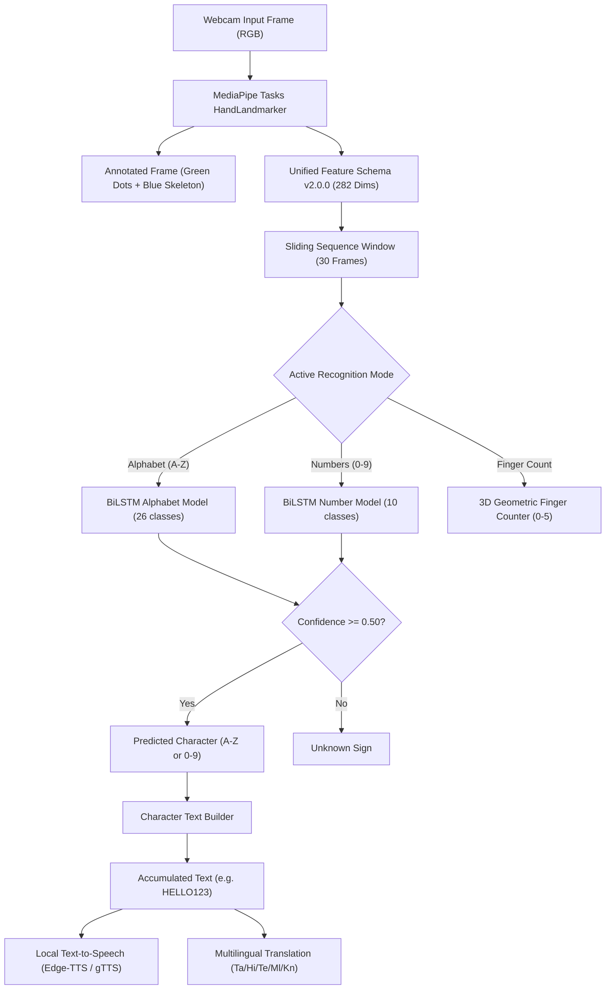

# SignBridge AI — Real-Time Indian Sign Language (ISL) Recognition

SignBridge AI is an AI-powered Indian Sign Language (ISL) recognition and assistive communication platform built in Python. It detects hands in real-time from a webcam, extracts MediaPipe hand landmark geometry, and classifies signs using deep learning.

---

## 1. Main Project Objective

SignBridge AI focuses exclusively on **character-by-character real-time Indian Sign Language recognition**:

1. **English Alphabet Fingerspelling (A through Z — 26 classes)**:
   - Recognizes static and movement-based ISL fingerspelling handshapes.
2. **Numbers (0 through 9 — 10 classes)**:
   - Recognizes standard ISL number signs (0 through 9).
3. **Character-by-Character Text Generation**:
   - Recognized characters assemble sequentially into readable text (e.g., `HELLO123`).
   - Supports manual confirmation, auto-add stabilization with neutral release gating, backspace, clear, multilingual translation, and local text-to-speech (TTS).

---

## 2. Key Features

- **Single Camera Interface**: Displays one unified webcam stream with high-contrast green landmark dots (radius 5) and blue skeleton connection lines.
- **Unified Feature Schema (v2.0.0)**: Fixed 282-dimensional feature vector (140 Left Hand + 140 Right Hand + 2 Hand Presence Flags) shared identically across training and live inference.
- **Strict Model Compatibility**: Explicitly rejects incompatible models (`IncompatibleModelError`); never silently pads, truncates, or slices feature dimensions.
- **Genuine Confidence Gating**: Unrecognized or low-confidence hand poses report `Unknown Sign`, preventing arbitrary word guesses on arbitrary finger poses.
- **Character Text Builder**: Add Character, Backspace, Clear Text, and Auto-Add with mandatory neutral hand release to prevent runaway duplicate characters (e.g., prevents `AAAAA`).
- **Per-Session State Isolation**: Gradio `gr.State` isolates recognition pipeline instances per user connection, preventing cross-user text contamination.
- **Multilingual Translation & TTS**: Translates text to Tamil, Hindi, Telugu, Malayalam, Kannada, and English with offline dictionary fallback and speech synthesis.
- **Complete Test Coverage**: 100+ automated unit and integration tests passing with 0 failures across all 15 audit dimensions.

---

## 3. Supported Recognition Classes

### Alphabet (26 Classes)
| Class | Category | Description / ISL Standard |
|---|---|---|
| `A`–`Z` | Alphabet | Standard Indian Sign Language (ISL) fingerspelling hand signs. Dynamic letters (such as `J` and `Z`) incorporate motion trajectories; static letters evaluate palm and finger kinematics. |

### Numbers (10 Classes)
| Class | Label | Description / ISL Standard |
|---|---|---|
| `0` | ZERO | Closed fist or circular 'O' shape |
| `1` | ONE | Index finger extended upright, others folded |
| `2` | TWO | Index and Middle fingers extended upright in V-shape |
| `3` | THREE | Thumb, Index, and Middle fingers extended |
| `4` | FOUR | Index, Middle, Ring, Pinky extended, thumb folded |
| `5` | FIVE | Open hand, all 5 fingers extended |
| `6` | SIX | Thumb touching Pinky tip, others extended |
| `7` | SEVEN | Thumb touching Ring tip, others extended |
| `8` | EIGHT | Thumb touching Middle tip, others extended |
| `9` | NINE | Thumb touching Index tip, others extended |

---

## 4. System Architecture



---

## 5. Repository Structure

```
sign 2/
├── app.py                                # Main application entry point (FastAPI + Gradio)
├── config.py                             # Central configuration and environment settings
├── backend/
│   ├── main.py                           # FastAPI application and Lifespan service manager
│   ├── api/                              # REST API endpoints (health, recognition, speech, translation)
│   ├── vision/
│   │   ├── feature_schema.py             # CANONICAL Feature Schema v2.0.0 (282-dim extractor)
│   │   ├── hand_landmarks.py             # MediaPipe Tasks HandLandmarker wrapper
│   │   ├── live_pipeline.py              # Real-time multi-mode processing pipeline
│   │   └── performance_monitor.py        # Sub-millisecond latency profiler
│   ├── recognition/
│   │   ├── isl_fingerspelling_recognizer.py # ISL Alphabet Recognizer (A–Z)
│   │   ├── isl_number_recognizer.py      # ISL Number Recognizer (0–9)
│   │   ├── character_builder.py          # Character Text Builder (Add, Backspace, Clear, Auto-Add)
│   │   └── finger_counter.py             # 3D invariant geometric finger counter (0–5)
│   ├── audio/                            # Text-to-Speech (Edge-TTS and gTTS fallback)
│   ├── database/                         # SQLite conversation storage
│   └── translation/                      # Multilingual translation service
├── frontend/
│   ├── translator_ui.py                  # Live ISL Camera & Character Builder UI (session-isolated)
│   ├── home.py, about_ui.py, etc.        # Auxiliary frontend tabs
├── isl_data_collection/                  # Dedicated ISL Alphabet & Numbers dataset recording tab
├── models/
│   ├── isl_fingerspelling_model.keras    # Trained BiLSTM Alphabet model (None, 30, 282 -> 26)
│   ├── isl_number_model.keras            # Trained BiLSTM Number model (None, 30, 282 -> 10)
│   ├── fingerspelling_labels.json        # Alphabet 26-class mapping
│   ├── number_labels.json                # Numbers 10-class mapping
│   └── hand_landmarker.task              # MediaPipe Tasks Hand Landmarker model
├── scripts/
│   ├── train_alphabet.py                 # Standalone Alphabet training script
│   ├── train_numbers.py                  # Standalone Numbers training script
│   ├── import_fingerspelling.py          # Fingerspelling dataset downloader & extractor
│   └── import_number_datasets.py         # ISLRTC numbers downloader & extractor
├── tests/
│   ├── test_alphabet_and_numbers_suite.py# 15-Area comprehensive verification suite
│   ├── test_feature_schema.py            # Feature schema & dimension tests
│   ├── test_character_builder.py         # Character text builder & auto-add tests
│   └── ...                               # 101 automated pytest test cases
├── docs/
│   └── project_audit.md                  # Comprehensive architectural audit and repair report
└── README.md
```

---

## 6. Installation & Setup (Windows PowerShell)

### Prerequisites
- Windows 10/11
- Python 3.11 or 3.12 (64-bit)
- Working USB webcam or laptop camera

### Step 1: Clone Repository
```powershell
git clone https://github.com/arunkumar-maa/sign.git
cd "sign 2"
```

### Step 2: Create & Activate Virtual Environment
```powershell
python -m venv .venv
.\.venv\Scripts\Activate.ps1
```

### Step 3: Install Dependencies
```powershell
python -m pip install --upgrade pip
pip install -r requirements.txt
```

---

## 7. Launching the Application

Start the FastAPI backend and Gradio web interface simultaneously:

```powershell
python app.py
```

- **Gradio Web Interface**: [http://localhost:7861](http://localhost:7861)
- **FastAPI Interactive Docs**: [http://localhost:8001/api/docs](http://localhost:8001/api/docs)

---

## 8. Webcam Usage & Recognition

1. Open [http://localhost:7861](http://localhost:7861) in your browser.
2. Select the **"🎥 Live ISL Translator"** tab.
3. Choose your desired recognition mode:
   - **Alphabet (A–Z)**: For spelling English words using ISL fingerspelling.
   - **Numbers (0–9)**: For ISL numbers.
   - **Finger Count (Diagnostic)**: To view exact count of extended fingers.
4. Under the camera accordion, click the webcam icon to grant camera permissions.
5. The live camera feed displays your video with green landmark dots on your knuckles/fingertips and blue skeleton connection lines.
6. **Assembling Text**:
   - Hold an ISL sign. When the predicted character appears with high confidence, click **"➕ Add Character"**.
   - Use **"⌫ Backspace"** to delete the last character or **"🗑 Clear Text"** to reset.
   - Click **"🔊 Speak Text (TTS)"** to hear the assembled string spoken aloud.
   - Toggle **"⚡ Auto-Add"** for hands-free typing (requires 6 stable frames + mandatory neutral release before repeating the same character).

---

## 9. Dataset Collection & Model Training

### Data Collection Tab
1. Switch to the **"ISL Data Collection"** tab in the web UI.
2. Select the category (**Alphabet** or **Numbers**).
3. Type the exact verified label (e.g., `A` or `5`) and your signer ID (e.g., `S01`).
4. Click **Start Recording**, perform the sign, and click **Stop Recording**.
   - *Quality check:* Samples without valid hand landmarks are automatically rejected to prevent corrupted data.
5. Click **"Extract Hand Landmarks"** to convert saved clips to 282-dim sequences via `backend/vision/feature_schema.py`.

### Standalone Model Training
Run dedicated training scripts directly from PowerShell:

```powershell
# Train Alphabet Model (A–Z)
python scripts/train_alphabet.py --epochs 25 --batch-size 16

# Train Numbers Model (0–9)
python scripts/train_numbers.py --epochs 30 --batch-size 16
```

Models and metadata are automatically verified and saved to `models/isl_fingerspelling_model.keras` and `models/isl_number_model.keras`.

---

## 10. Running Automated Tests

Run the full automated test suite (101 tests):

```powershell
python -m pytest tests/test_alphabet_and_numbers_suite.py -v
python -m pytest -v
```

All 15 required audit areas are tested, including:
- Alphabet & number label mappings
- 282-dim feature schema parity
- Missing hand and corrupted sample rejection
- Rejection of incompatible model architectures
- Low-confidence `Unknown` gating
- Character builder, backspace, clear, and auto-add stabilization
- Model input/output dimensions and camera pipeline integration

---

## 11. Known Limitations

1. **Camera Lighting & Background**: High contrast with hands clearly separated from backgrounds provides optimal MediaPipe hand tracking. Avoid extreme backlighting.
2. **Two-Hand Occlusion**: When both hands cross directly over each other in front of the lens, landmark tracking may momentarily drop to one hand until separated.
3. **TTS Internet Access**: Edge-TTS and gTTS require an active internet connection to download audio streams; offline TTS fallback uses system pyttsx3 when configured.
